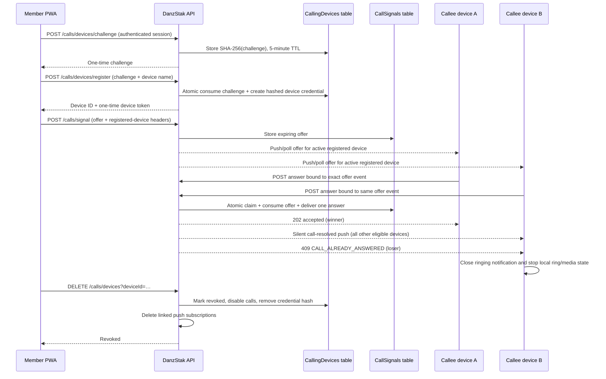

# SYNC device registration

Status: **Registered-device baseline deployed; immediate multi-device answer resolution implemented and under release verification.**

SYNC device registration authorizes one browser/PWA installation to use DanzStak account-to-account messaging and voice/video signaling. It does not verify a handset subscriber, activate a carrier number, enable PSTN/SMS/emergency calling, or gate Friends, profiles or signup. As of the owner decision on 2026-11-11, private conversation and message routes require the same current-device credential as calls.

## Register → call → one device answers → revoke

## API contract

| Method and route | Purpose | Important controls |
|---|---|---|
| `POST /calls/devices/challenge` | Begin enrollment | Authenticated session, trusted mutation origin, random 32-byte challenge, digest stored for five minutes |
| `POST /calls/devices/register` | Register one installation | Challenge digest timing-safe comparison; atomic challenge consumption; maximum ten active installations; token returned once |
| `GET /calls/devices` | List the member's devices | Account partition only; returns name, status, registration time, last use and current-device hint; never returns token hashes |
| `PATCH /calls/devices` | Rename or allow/disable calls | Account-scoped conditional update; revoked devices cannot be re-enabled |
| `DELETE /calls/devices` | Revoke a device | Removes token hash, disables calls and deletes linked push endpoints |
| `POST /calls/signal` | Offer, answer or hang up | Phone/video requires registered-device headers; contact authorization remains enforced |
| `GET /calls/inbox` | Foreground call polling | Registered active device required; internal answer-claim records are excluded |
| `POST /calls/ack` | Consume handled signals | Registered active device required; account partition only |

## Data model

`DANZSTAK-CallingDevices` uses `userEmail` as its partition key and `deviceId` as its sort key.

- Challenge record: `CHALLENGE#<UUID>`, challenge digest, creation time and TTL.
- Registered record: random UUID, editable name, SHA-256 device-token digest, `allowCalls`, registration time, last-use time and optional revocation time.
- The browser keeps the returned device ID and token in origin-scoped IndexedDB. They are sent only as request headers to DanzStak call/push endpoints and never in URLs.
- The table is encrypted, retained across stack updates, protected by point-in-time recovery, and uses TTL only for short-lived challenge cleanup.

`DANZSTAK-CallSignals` remains the short-lived signaling table. A successful answer adds `CLAIM#<callId>` and removes the exact offer in the same DynamoDB transaction that writes the answer for the caller. The claim expires with the call window.

Push subscriptions remain separate records. A subscription is call-eligible only when it is linked to an active registered device with `allowCalls=true`. Denying push permission does not prevent foreground call polling. After the one-answer transaction commits, the backend sends a silent `call-resolved` push to every other eligible registered device, excluding the winning device. The service worker closes the matching ringing notification and tells open DanzStak pages to stop their local ringtone and vibration. The push contains only the opaque call ID; account addresses and message content are not included.

## Security and operating risk

- The installation secret is a high-entropy bearer credential, not a hardware identity and not guaranteed to be non-exportable or hardware-backed.
- Stolen browser storage plus a valid account session remains a risk; account session checks, account-scoped lookup and immediate revocation limit it. A future reviewed design may add a non-exportable WebCrypto possession key without claiming hardware attestation.
- Device activity writes are throttled to roughly once per minute so two-second foreground polling does not create a DynamoDB write on every request.
- Call records and answer claims expire automatically. Calling devices are durable security records and must be explicitly revoked.
- Ten active devices is an abuse/safety cap, not a paid entitlement.
- Devices without an active push subscription still stop on their next two-second inbox reconciliation. Push delivery is a latency improvement rather than the correctness boundary; the DynamoDB transaction remains the authoritative one-answer control.
- Production release requires an isolated AWS review stack, two accounts, at least two real receiving installations, push-denied foreground coverage, real two-way audio/video, revoke/reinstall tests, and owner approval.

