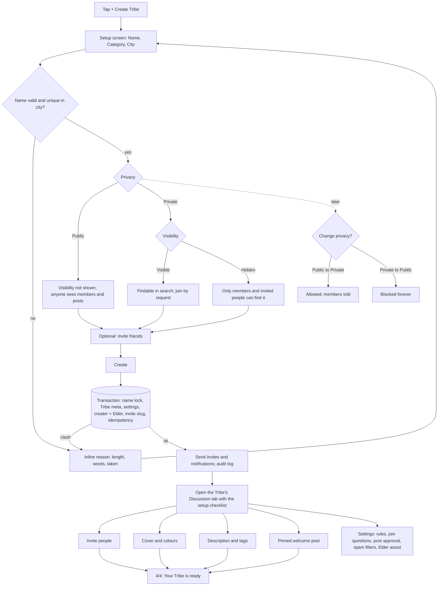

# 29a: Tribe creation and Elder setup — full design (owner, 2026-11-18)

The owner asked for a complete, Facebook-Groups-style design for creating a Tribe, from **+ Create Tribe** to a finished Elder setup checklist. The owner's choices: the **current DanzStak stack** (a phone-first PWA in plain JavaScript; AWS Lambda behind API Gateway; DynamoDB), **both the UI and the backend**, and **no extra rules for now** (Tribes are free, with no badges, paid entry or subscriptions).

Names: Group = **Tribe**, Admin/Owner = **Elder**, Moderator = **Moderator**, members = **The Crew**. This document refines `29-tribes-like-groups.md` (which covers the feed, roles and posts) for the creation flow only. Build it as part of queue 5a9.

---

## 1. Pre-creation setup screen

**Entry points:**
- Tribes top bar **+**;
- "+ Create Tribe" in the empty state;
- Menu → Tribes → +.

Each opens `feed.html#tribes/new`, a full screen with ← Back and a "Create Tribe" title. Back with unsaved input asks "Discard this Tribe?"; the draft is kept in `sessionStorage` until Create or Discard.

**Layout (phone-first "split view"):**
- **Phones (< 700px):** the preview card sits pinned at the top (about 30% of the height, and it shrinks while the keyboard is open), with the form scrolling below.
- **Wider screens:** the form is on the left (420px) and the live preview on the right, showing what members will see on phones.

**Inputs, in order:**

| Field | Rules | UI |
|---|---|---|
| **Name** (required) | Trimmed; 3–75 characters; letters, numbers, spaces and `& ' - . ! ? # / ,`; collapse repeated spaces; no URLs or @handles; profanity and slur filter (the shared moderation word list; matches show "Pick a different name"); can't impersonate (names containing "DanzStak", "Official" or "Admin" are blocked). **Uniqueness:** a case- and accent-insensitive name key must be unique **within the same city** (so "Punk Night Bologna" can exist once in Bologna, and other cities can have their own). The server is final; the client checks as you type (debounced 400 ms, `GET /tribes/name-check?name=&city=`). | Counter "12/75"; inline ✓ "Name available" or a reason. |
| **Category** (required) | One of: Bands, DJs & Producers, Promoters & Events, Fans, Industry & Crew, Record shops, Radio, Local scene, Other. | A row of chips. |
| **City** (optional) | Free text with a suggestions list from DanzStak's city list; stored as the normalized city key. | Text field with suggestions. |
| **Privacy** (required, default **Private**) | **Public:** anyone signed in can see members and posts. **Private:** only members can see members and posts. | Two large radio cards, each with an icon and a one-line explanation. |
| **Visibility** (only when Private; default **Visible**) | **Visible:** anyone can find the Tribe in search and Discover and ask to join. **Hidden:** only members and invited people can find it. | Appears under Private with a 150 ms height animation and disappears for Public. |
| **Invite friends** (optional) | Typeahead over **your friends** (`GET /friends?q=`), multi-select chips, at most 50 at creation. Never phone numbers or contacts. | Search field with chips; "You can invite more later." |
| **Create** | Enabled when the name is valid and a category is picked. Double taps are prevented (it shows a spinner, and an idempotency key is sent). | The one primary button at the bottom (sticky, above the safe area). |

**Privacy immutability (shown as a note under Privacy):**
- Public → Private: allowed any time (members are told).
- **Private → Public: never.** The setting is locked once created, and Elders see "Private Tribes can't become public, to protect members' privacy."
- Hidden → Visible and Visible → Hidden: Elders only, at most once every 7 days.

**Live preview component (`TribePreview`):** a card made of:
- the cover (a genre cover from the category, or the uploaded photo later);
- a rounded-square avatar with the centred initial;
- the name in the display font, updating on every keystroke via `requestAnimationFrame`;
- a line "🔒 Private · Hidden · Local scene · Bologna" that updates as the fields change;
- a ghost "Join" button and "1 member · you".

It uses the same component as the real Tribe header, so the preview matches exactly, and it uses no network.

---

## 2. Creation and role provisioning (on Create)

`POST /tribes` with `{ name, category, city, privacy, visibility, inviteMemberIds[], idempotencyKey }`

**On the server (one DynamoDB `TransactWriteItems`; it all succeeds or nothing is written):**
1. Re-validate everything: name rules, profanity, length, category and visibility allowed. Rate limit: 5 Tribes per member per day, and 50 Tribes owned at most.
2. Uniqueness: `Put` a `TRIBENAME#{city}#{nameKey}` item with `attribute_not_exists`. A clash returns 409 "That name is taken in {city}".
3. `Put` the Tribe meta item: `tribeId` = UUID, `createdBy`, `status: "active"`, `privacyLockedAt` set when Private, `setupChecklist` all false.
4. `Put` the `TribeSettings` item with the defaults (below).
5. `Put` the creator's `TribeMember` item: `role: "elder"`, `status: "approved"`, `joinedAt`.
6. `Put` the invite slug item `TRIBEINVITE#{slug}` → tribeId. The slug is 10 characters of base32 random data; it never expires until an Elder resets it, and it carries no personal data.
7. Idempotency: a `Put` of `IDEMP#{memberId}#{key}` with a 24 h TTL, so a retry returns the same Tribe.

**After the transaction:**
- create invites (`TribeInvite` items, status `sent`) and queue in-app notifications ("Shawn invited you to Punk Night Bologna"), via the existing notifications path;
- write an audit-log item ("created").

**Response:** `201 { tribe, myMembership, inviteUrl: "https://danzstak.com/t/{slug}" }`. The client goes straight to `#tribes/{tribeId}`, Discussion tab, with the setup checklist open.

---

## 3. "Finish setting up your Tribe" checklist (Elders only)

It sits at the top of Discussion as a card with a progress bar (0/4 … 4/4) and **Hide** (Elders can bring it back from Settings).

| # | Task | Done when | Screen |
|---|---|---|---|
| 1 | **Invite people** | ≥ 1 invite sent or link shared | A sheet with a friends typeahead, **Copy link**, **Share** (native share sheet) and a **QR** of the invite link. |
| 2 | **Add a cover and colours** | The cover is set (and the colours saved) | Upload a photo (crop to 16:9, max 12 MB, JPEG/PNG/WebP; never audio) or pick a DanzStak genre cover. **Theme colour**: the 4 genre looks (Techno, Punk, Metal, House) as tokens, plus an accent picker limited to colours that pass 4.5:1 contrast on the Tribe header. |
| 3 | **Description and tags** | The description has ≥ 20 characters | Description (max 1,000 characters; links shown as text unless the Tribe allows links) and **tags**: up to 5 from a fixed list (punk, hardcore, metal, doom, techno, house, drum & bass, DIY, all-ages, vinyl, radio, crew…) plus the category. |
| 4 | **Welcome post** | A pinned post by an Elder exists | Opens the composer with a prompt ("Say hi and tell people what this Tribe is for"). On Post, the post is created and **pinned** (`isPinned: true`), so newcomers never see an empty feed. |

When 4/4 is reached, the card shows "Your Tribe is ready" once and then goes away. The state lives in `setupChecklist` on the meta item, and each task's API sets its own flag.

---

## 4. Governance and moderation (Tribe ⋮ → Settings → Rules and moderation)

**Rules:** up to 10, each with a title (≤ 60 characters) and a description (≤ 300 characters). One-tap templates:
1. "Be kind and courteous"
2. "No hate speech or bullying"
3. "No spam or self-promotion without asking"
4. "Respect the scene, the venues and the crews"
5. "No bootlegs or copied music; links to the artist's own pages only"
6. "Keep it on topic"

Elders can also add custom rules and reorder them by dragging (with an accessible move-up/move-down alternative).

**Membership screening (Private Tribes):**
- up to **3 questions**, each **written** (≤ 250-character answer), **multiple choice** (2–6 options) or **checkboxes**;
- **"Require agreement to the rules"** toggle, which adds a must-tick "I agree to the Tribe rules" to the join request.
- Answers are visible to Elders and Moderators on the request, and **deleted when the request is approved or declined** (or after 30 days pending).

**Moderation defaults (`TribeSettings`):**
- **Post approval:** **Off** (default) / **New members only** (their first 7 days, or their first 3 posts) / **All posts**.
- **Spam filters (plain rules, no scoring or ranking):**
  - hold posts with links from members who joined less than N days ago (default 3);
  - hold posts that repeat the same text 3 times within 24 h;
  - hold posts containing words from the Elder's blocked-words list (up to 100 words).
  - Held posts go to **Pending posts** for Moderators.
- **Elder assist** (optional, off): auto-approve join requests from friends of current members, or from accounts older than N days that answered all the questions.
- **Anonymous posts:** off by default.
- **Who can post:** everyone in The Crew (default), or only Elders and Moderators (announcement Tribes).

All settings changes are written to the audit log (who, what, when).

---

## 5. Flowchart

---

## 6. Data model (DynamoDB, existing `DANZSTAK-GroupMembers` table)

This keeps the existing key shape: partition key `userEmail`, sort key `groupId`. Tribe-level items use a `GROUP#{tribeId}` partition, as the current code already does for `META`. A new GSI `byTribe` (partition key `gsiTribe`, sort key `gsiSort`) lists members, requests and invites per Tribe.

**Tribe** (`userEmail = GROUP#{tribeId}`, `groupId = META`)

| Attribute | Type | Notes |
|---|---|---|
| tribeId | S | UUID |
| name, nameKey | S | display name; normalized key for uniqueness |
| category | S | enum above |
| city, cityKey | S | optional |
| privacy | S | `public` \| `private` |
| visibility | S | `visible` \| `hidden` (private only) |
| privacyLockedAt | S | set when private; blocks private → public |
| description | S | ≤ 1000 |
| tags | L | ≤ 5 |
| coverKey | S | media key; never audio |
| theme | M | `{ look, accent }` |
| createdBy | S | memberId |
| memberCount | N | approved members, updated in the same transactions |
| status | S | `active` \| `archived` \| `deleted` |
| setupChecklist | M | `{ invited, cover, description, welcomePost, hiddenByElder }` |
| inviteSlug | S | current slug |
| createdAt, updatedAt | S | ISO |
| revision | N | optimistic locking |

**TribeSettings** (`GROUP#{tribeId}` / `SETTINGS`)

| Attribute | Type | Default |
|---|---|---|
| rules | L of `{id,title,description,order}` | [] |
| questions | L of `{id,type: written\|choice\|checkbox,prompt,options[]}` | [] (max 3) |
| requireRulesAgreement | BOOL | false |
| postApproval | S | `off` \| `new_members` \| `all` (default `off`) |
| spam | M | `{ linkHoldDays: 3, repeatHold: true, blockedWords: [] }` |
| elderAssist | M | `{ enabled: false, friendsOfMembers: false, minAccountAgeDays: null }` |
| allowAnonymous | BOOL | false |
| whoCanPost | S | `crew` \| `staff` |
| visibilityChangedAt | S | enforces once per 7 days |

**TribeMember** (`userEmail = {memberEmail}`, `groupId = {tribeId}`; also `gsiTribe = GROUP#{tribeId}`, `gsiSort = MEMBER#{role}#{joinedAt}`)

| Attribute | Type | Notes |
|---|---|---|
| tribeId, memberId | S | |
| role | S | `elder` \| `moderator` \| `member` |
| status | S | `pending` \| `approved` \| `banned` \| `left` |
| answers | L | only while pending; deleted on decision |
| agreedToRulesAt | S | when required |
| invitedBy | S | optional |
| joinedAt, decidedAt, decidedBy | S | |
| mutedUntil | S | optional |

**Other items:**
- `TRIBENAME#{cityKey}#{nameKey}` / `LOCK`: name uniqueness.
- `TRIBEINVITE#{slug}` / `LINK`: maps the slug to tribeId.
- `GROUP#{tribeId}` / `INVITE#{memberId}`: direct invites (`sent` \| `accepted` \| `declined`, with a TTL of 60 days).
- `GROUP#{tribeId}` / `AUDIT#{ts}#{id}`: settings and moderation log (actor, action, before/after summary, with a 2-year TTL).
- `IDEMP#{memberId}#{key}`: create idempotency (24 h TTL).

---

## 7. API (Auth API or the call-signaling Lambda; follow the current route style)

| Route | Who | Does |
|---|---|---|
| `GET /tribes/name-check?name=&city=` | signed in | `{ ok, reason }` (rate limited) |
| `POST /tribes` | signed in | creates the Tribe (section 2) |
| `GET /tribes/{id}` | per privacy | meta, settings that member may see, myMembership, checklist (Elders) |
| `PATCH /tribes/{id}` | Elder | name (re-validated and re-locked), description, tags, cover, theme, privacy (Public → Private only), visibility (7-day rule) |
| `PUT /tribes/{id}/settings` | Elder | rules, questions, approval, spam, Elder assist (Moderators may change post approval) |
| `POST /tribes/{id}/invites` | members (Elders/Mods for Hidden) | direct invites to friends |
| `POST /tribes/{id}/invite-link/reset` | Elder | new slug; the old one stops working |
| `GET /t/{slug}` | anyone signed in | resolves to the Tribe page (Hidden Tribes only through a valid slug or invite) |
| `POST /tribes/{id}/join` | signed in | Public → approved; Private → pending with answers and rules agreement; Elder assist may approve |
| `PATCH /tribes/{id}/members/{memberId}` | Elder/Mod | approve, decline, ban, mute, role (role changes are Elder only) |
| `POST /tribes/{id}/posts` (+ `pin`) | per settings | welcome post pinned by Elders |

Every route checks permissions on the server. Responses never include emails or phone numbers, only memberIds, names and avatars.

## 8. Build order (Claude Code, one PR each; backend deployed by the owner's session)
1. Setup screen + live preview + client validation (with the server mocked in tests).
2. `POST /tribes`, name-check, the transaction, invites, slug (+ server tests).
3. Setup checklist + cover/theme + description/tags + pinned welcome post.
4. Settings: rules templates, join questions, rules agreement, post approval, spam rules, Elder assist, audit log.
5. Browser checks at 320/360/390/430px with screenshots for every screen state (Public, Private Visible, Private Hidden, name taken, checklist 0/4 → 4/4).
