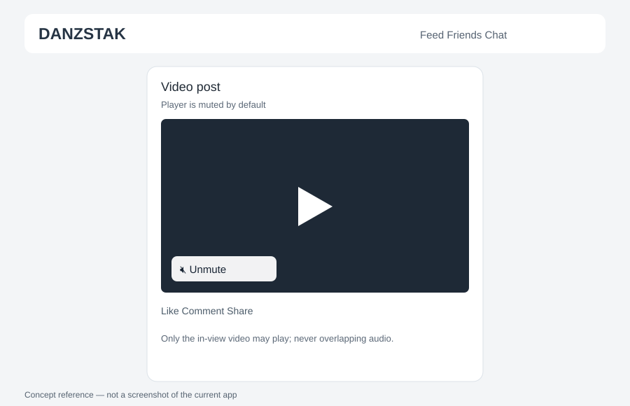

# 01 — Video playback, audio isolation and player framing

## Reported defects (verify in current app)
- YouTube video may play as soon as the app opens, including when not visible.
- Audio from multiple videos may overlap.
- A visible audio mute/unmute control is missing or inadequate.
- Dark/black lines appear around embedded video players.

## Required behavior
1. **Autoplay is required for eligible in-view videos, muted by default.** When the feed opens, the first sufficiently visible video should autoplay silently where browser/provider policies allow. Never autoplay an offscreen player or start audio without a user action.
2. As the user scrolls, automatically play the most-visible eligible video (muted by default) and pause all others. At most one video may be playing at a time; offscreen players must pause, not merely mute. Use intersection visibility thresholds and robust lifecycle cleanup.
3. Provide a clearly visible, accessible mute/unmute button on each playable video; initial state must be muted. Unmuting requires a user action.
4. Respect browser autoplay policies. If an external provider blocks programmatic control, show a click-to-play state rather than falsely claiming playback control.
5. Prevent playback from persisting after route changes, tab changes, modal close, or component unmount.
6. Normalize player container aspect ratio and background, eliminate unintended borders/stripes, and avoid cropping important content.
7. Support YouTube and other existing supported external embeds without downloading/rehosting media.
8. Do not modify unrelated feeds or authentication.

## Acceptance tests
- Initial page load: the first visible eligible video autoplays silently, where permitted; zero audible videos.
- Scroll through 5+ video posts: the visible video autoplays silently; previous players pause; never two simultaneous audio streams.
- Unmute a visible video, then scroll it offscreen: it pauses.
- Navigate away from feed: all players stop.
- Test on Android Chrome, desktop Chrome, and any available Safari environment.
- Confirm player edges have no unintended black border; distinguish provider letterboxing from CSS defects.
- Record exact automated tests, manual test environments, and any unverified providers.

## Codex deliverables
Root-cause analysis, changed file paths, PR, test results, before/after screenshots, known provider limitations.

## Final owner directive — The Roll fullscreen sound and 50% swipe handoff (2026-11-04)

**Owner Android screenshot:** The Roll fullscreen shows a large "The Roll / Externally hosted videos" header, expand and close buttons, portrait video with unused surrounding space, and a distinct black metadata footer. Owner calls the appearance cookie-cutter and wants sound to play **on opening fullscreen**, then automatically carry to each new video, with **50% visibility handoff**. These are specific to The Roll, not permission for unsolicited sound in the ordinary feed.

### Immersive, original DANZSTAK Roll UX
1. **Tap Open The Roll** (explicit gesture) -> an immersive full-viewport vertical player with minimal Back/Close, caption/creator overlays and a compact side action rail where real like/comment/share/save features exist. Remove oversized black heading/footer, wasted framing, duplicate fullscreen buttons and generic panels without hiding source attribution or critical controls.
2. Vertical swipe up/down -> one **video per viewport**, comfortable scroll-snap, no large gaps or janky transitions. Fill the available screen sensibly while preserving 9:16 or source aspect ratio; do not stretch/crop important content, and distinguish provider letterboxing from CSS defects. Respect Android system bars and safe areas.
3. **At 50% out-of-view:** measure each card's visible pixel intersection ratio against the Roll scroll viewport. When the old video has **50% or less visible (<=0.50)**, pause it and stop its audio. When the next card is predominant and **>=0.50 visible**, start it automatically. Use a **single authoritative active video** and deterministic tie-breaking/hysteresis near exactly 50/50 to avoid rapid switching; always stop outgoing audio before enabling the incoming video's audio. Do not switch while actively operating its progress slider or comment sheet.
4. **Sound when opening fullscreen:** on the member's deliberate Open Roll tap, attempt an allowed audio unlock so the first eligible video starts with sound. Carry the member's **unmuted or muted choice for the rest of that Roll session**, so advancing clips never requires another sound-button tap. One visible and accessible Speaker/Mute control can change it for all subsequent clips. On Android/iOS/provider restrictions, do not fake success: a **one-time Tap to enable sound** action may be necessary. Do not bypass browser autoplay policies, OS/device silence or provider limits.
5. **Outside The Roll:** Your Mix feed remains **muted by default**. Never automatically play offscreen audio on app load. Closing Roll, leaving tab, opening a call, browser background, or navigating away pauses/unloads and silences every Roll player immediately. Preserve user control and optional data saver.
6. **External video reality:** existing Roll uses HTML5 videos plus cross-origin iframe players. The current reelPlaybackObserver in assets/feed-enhancements.js only pauses HTML5 video when below 60% visible; it does not reliably start the next, and iframe controls differ. Extend a centralized media coordinator to manage active playback/mute of HTML5 and provider-specific embeds **only where provider API allows it**. For iframe content that cannot be paused/unmuted reliably, unload/suspend offscreen to avoid audio bleed and show an honest click-to-play fallback; do not claim Instagram-like control where the provider blocks it. DANZSTAK remains independent from Meta/Instagram login, code and terms for its own content.
7. Preload current and at most one adjacent video while respecting data saver and network cost. Graceful buffering/retry/unsupported player states. Preserve author/profile/link/comments where supported, screen reader access, reduced motion and mobile keyboard/pointer behavior.

### Acceptance test and owner gate
- Audit actual assets/feed-enhancements.js functions setRollFullscreen, reelPlaybackObserver, renderPlayableReels, the CSS .roll-fullscreen/.reels-list rules, and global media visibility coordinator before coding; explain measured defects rather than creating another separate video feed.
- On **two or more real test clips** in an **installed Android phone PWA**, tap Open Roll and hear sound where browser/user gesture allows; swipe A->B->C without pressing sound again; verify video A pauses at <=50% visible, B starts once predominant >=50% visible, never two audible streams, mute persists, swipe backwards, video errors handled, closing stops sound immediately. Distinguish browser-policy failures from implementation bugs.
- Test precise 50/50 ties, fast swipe/reverse, buffering/network loss, pause while scrolling controls, external YouTube embed vs direct video, tab background, video call audio focus, PWA history/back, 320/360/375/390/414/430px and desktop. Record supported/uncontrollable providers honestly. Include mobile screenshots and actual sound playback evidence, not only CSS/layout static tests.
- Codex: independent small PR, reproducible pass/fail evidence, SHA, verified **phone-accessible staging PWA**, exact provider limitations and **owner approval before merge/deploy**. This specification does not establish a completed feature.

**User promise:** Open the Roll and hear the active video, swipe, hear the next, never overlapping videos, no need to press sound on each video.

## Owner clarification — Keep existing Roll, polish like Instagram (2026-11-04)

**Exact final intent:** The public name stays **The Roll** and it remains the same **existing DANZSTAK video product/content destination**. Do not rename it, replace it, move its videos into a separate product or revive Rough Cut. The owner wants a **better feeling, smoother, more polished Instagram-Reels-familiar user experience**, NOT a copied Instagram UI or an account/API integration.

- Retain existing accounts, creator identities, uploaded videos, external embeds, share/source links, rights checks, privacy, engagement records and route/Back behavior. Improve the existing Roll player in-place, not a new feed or migration.
- Improve mobile touch UX: natural full-height vertical swipes, one clear video per viewport, fluid snap and no jitter, clipping, huge black gaps or generic cards. Fit video to device aspect without distorting/cropping key content; subtle overlay creator name/caption and unobtrusive real actions. Keep a small discoverable Close/Back and accessible mute button.
- Maintain previously approved **50%-out-of-view pause / >=50%-visible next play** handoff, with exactly one active media owner and tie stability. Entering fullscreen is a deliberate gesture: play audio when allowed; **keep the session-level audio preference while swiping** so a person doesn't unmute each clip. Only request a further gesture when browser/provider restrictions require it, and be truthful about limitations.
- The Mix remains an independent scrollable social feed (muted by default); Dailies remains a separate 24-hour feature. Do not install Instagram SDK, require Meta login, replicate proprietary visuals or rehost videos that were supplied as external embeds.
- Quality bar is perceived smoothness on **real Android PWA**, not just a static mockup: test repeated swipes, rapid reversals, load/transition times, mixed native and supported embed sources, audio bleed, tap targets, accessibility and background/call interruptions. Compare real before/after staging recordings/screenshots. If a provider cannot be controlled, give a graceful fallback rather than fake smooth autoplay.
- Codex implementation on its development branch, isolated PR, real device tests, staging preview and explicit owner approval before production deployment.

**Design sentence:** "The Roll keeps its name and content; only the viewing experience becomes more fluid, immersive and comfortable."

## Global and creator-specific fullscreen queues — back-to-back video viewing (owner clarification, 2026-11-04)

The owner says that clicking The Roll should open fullscreen and play all videos in The Roll **back-to-back, without horizontal browsing**. The owner separately wants fullscreen entry from any user's individual video to play **all that user's videos across DANZSTAK**, skipping their ordinary non-video profile posts.

- **Global The Roll entry:** Tap The Roll and enter the **existing fullscreen vertical Roll player** showing its entire access-controlled video queue, not an additional carousel, separate Rough Cut or renamed feature. Start the current selected clip, automatically play the next after a clip finishes **where supported**, and allow swipe up/down to next/previous at any point. No horizontal scrolling within the fullscreen viewer; any horizontal preview rail in The Mix serves only as a launcher.
- **Creator-only entry:** Tap an individual user's video fullscreen from their profile, post, or Roll card. Open **that exact video** and queue only other playable videos genuinely posted by the **same server-identified creator**, regardless of where they appear on DANZSTAK. **Skip all their intervening text, photos, non-video events, comments and other members' videos.** Swipe or play to end to move directly to the next authorized video by that creator. At creator-playlist end, show an explicit end state or option to switch to All of The Roll; don't silently change creators.
- Preserve the 50% **actual visible video pixels** scrolling handoff: outgoing clip pauses and is silenced at <=50% visible, next predominant eligible >=50%-visible clip starts, always one active playback owner. Natural video end also advances automatically when provider supports end-state control. **Keep the session sound preference** after user enters fullscreen; one explicit audio gesture may be necessary due to browser restrictions but not one per clip where supported.
- Build the queue from account-authorized server data and stable video owner IDs rather than relying on DOM cards already loaded on one page. Include properly attributed videos within The Mix, The Roll and eligible media sections; deduplicate clips shared in multiple places, paginate lazily, and filter by audience, friends/blocks, deletion, copyright/moderation and expiration of Dailies. No unauthorized media URLs or metadata revealed. Preserve current video IDs/URLs and creator attribution.
- On Back/Close, return to the originating post/profile and scroll/focus position; stop all media sound. For cross-origin providers without playback/end/audio controls, show a candid tap-to-play/continue fallback; do not fake seamless autoplay or bypass provider policies.

**Do not conflate Dailies with The Roll:** Dailies is a separate 24-hour photo/video story product but should adopt the same fluid fullscreen **vertical** viewing, 50%-handoff, and user-selected sound behavior as described in its own specification; photos auto-advance after a reasonable pauseable duration and videos when they actually end.

**Codex acceptance:** Test (1) opening global Roll and watching 3+ different creators' clips continuously/with vertical swipes, (2) opening an older video of creator A and getting only A's clips scattered through profile posts (skip photos/text), (3) 50% threshold audio handoff and one player, (4) 24-hour Daily exclusion, blocking/deletion/pagination, (5) provider restrictions, real Android PWA sound and mobile keyboard/back gesture. Isolated PR, exact SHA, phone-accessible staging PWA, evidence and owner approval before production.

## Three strictly separate playback queues — owner final correction (2026-11-04)

**Owner explicitly corrected prior explanations:** "No the roll plays the collection of videos. If a user opens another user's videos it plays just that users videos and if the user opens dailys it plays just the dailies."

This is a strict source-and-navigation rule. Three separate entry points may share a technical fullscreen playback engine, but **they MUST NOT share or automatically mix their content queues**:

1. **Open The Roll:** immersive vertical queue of **all videos that are actually in The Roll** and viewable by that member, from multiple creators. Not every video from all DANZSTAK features. On video end, play the next Roll clip when technically supported; swipe up/down moves to next/previous **Roll** clip. No horizontal clip-by-clip navigation once fullscreen is open.
2. **Open another member's videos** from that member's video collection/profile or one of their video posts: creator-scoped vertical queue of **only videos posted by that specific member across their ordinary video surfaces (including Mix and Roll)**, skipping that member's text/photo/event posts and all other creators. Start at the exact tapped video. Do not include content that exists **only as an ephemeral Daily** in this ordinary-video queue, unless the creator separately published the same video as an ordinary video.
3. **Open Dailies:** vertical fullscreen queue of **only active, viewable Dailies**, including Daily photos/text and Daily videos, subject to their 24-hour expiry. No ordinary Roll videos, no standard video posts. Starting from the Dailies section can show all viewer-permitted active Dailies in defined order; opening a particular person's Daily starts at that selected Daily and can keep that person's Dailies grouped first. The entire viewer remains Dailies-only. See Dailies spec for detailed navigation.

**Queue isolation is mandatory:** no implicit change from global Roll to creator mode, from creator videos into Dailies, or from Dailies to Roll, even after an item ends or a creator runs out of clips. Show a clear end state or explicit action to switch modes. Do not assemble queues from whatever cards happen to be loaded in the DOM; use verified content type, source and creator IDs with backend authorization.

The other approved rules remain: native vertical/swipe fullscreen UX, one active player, 50% of **outgoing video's pixels** offscreen -> pause it and hand off to the next predominant item in the CURRENT queue, session-level sound preference where allowed, natural-end auto-next for controllable videos, privacy/expiry, accurate source labels and safe Back/Close restoration.

**Acceptance:** seed two users' Roll clips, creator-only ordinary videos outside Roll, and multiple active Dailies (video, photo and text). Open each of the three entry points and verify that no item from the other two queues leaks into it; check every next and previous action and end-of-list, including older clips, expired Dailies and blocked users. Real installed Android PWA playback/swipe and sound tests, staged PR and owner approval required. This correction overrides any older wording suggesting "all videos" means all media across products.

## Final owner navigation — four entry points, two multi-creator collections (2026-11-04)

**Definitive rule from owner:** Both **The Roll** and **Dailies** are independent, multi-creator collections. **Only a video opened from The Mix or from a person's profile gets a creator-only playlist.** This overrides earlier language that treated opening a video from The Roll as creator-only, or made Dailies stop at the selected creator.

| Launch surface | Before tapping | Fullscreen starting item | After swiping up / video finishes |
| --- | --- | --- | --- |
| **Dailies** | Horizontal creator/Daily tiles in The Mix | Exact tapped Daily | The next **Daily from any permitted creator**; never a Roll or standard Mix post |
| **The Roll** | Horizontal left-right Roll video preview carousel | Exact tapped Roll video | The next **Roll video from any permitted creator** |
| **Video in The Mix** | The ordinary mixed-content feed | Exact tapped video | **Only that video's creator's regular videos**, collected across their authorized posts; skip text/photos |
| **Video on a user's profile** | That person's profile | Exact tapped video | **Only that profile member's regular videos**, collected across their authorized posts; skip text/photos |

All four launch the **same fluid fullscreen vertical player**, but with an explicit, immutable-for-session playlist scope: daily / roll / creator. Horizontal swiping is for **previews before entering fullscreen**. Once open, use vertical swipe up/down for next/previous, autoplay next on natural end only when provider/player allows, and keep showing the selected scope until Close or an explicit mode change. The chosen video must play first, not reset to item 1. Do not navigate away at creator boundaries within global Roll/Dailies collections.

All queues must use backend-authorized content IDs and stable creator IDs, not visible DOM cards alone. Enforce audience/privacy/block/deletion, 24-hour Daily expiry, pagination and deduplication. Daily-only ephemeral posts must not appear in creator regular-video queues unless separately published as standard videos. Keep one media/audio owner, 50%-of-video-pixels-out-of-viewport play/pause handoff, session-level user-enabled sound where supported, correct Back restoration and browser/provider autoplay fallbacks. Do not rename The Roll or create a separate Rough Cut.

**Owner acceptance:** Two creators each upload Roll clips, ordinary Mix/profile videos and eligible Dailies. (1) Tap second Roll preview horizontally, open that exact clip, swipe vertically to another creator's Roll clip. (2) Tap a Daily, swipe vertically to the next Daily even if by a different member. (3) Tap creator A's Mix video -> only A's standard videos. (4) Tap creator B's profile video -> only B's standard videos. No cross-scope leakage. Test true Android PWA touch/audio, 50% handoff, stage and seek owner approval; document unsupported third-party media separately.
