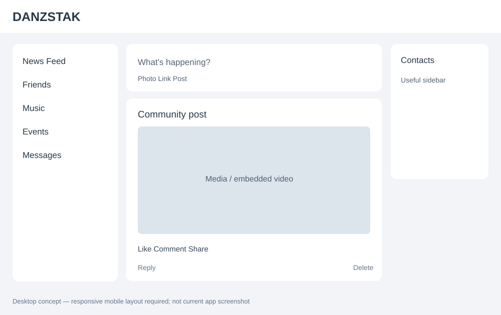

# 02 — Feed layout and navigation

## Goals
- Familiar, Facebook-like **light-mode** social layout with distinctive DANZSTAK branding, not a literal clone.
- Desktop: top navigation, useful left sidebar, readable central feed, optional right utility rail.
- Mobile: full-width feed, compact header, usable navigation; no horizontal overflow.
- Remove excessive blank white space, awkward padding, and unnecessary double-height action rows.
- Reply and delete/trash controls belong on the same horizontal row, with trash aligned to the far right when authorized.
- Maintain responsive spacing and accessible tap targets; no cookie-cutter cards or oversized empty regions.

## Acceptance
- Test 360px, 390px, 768px, 1280px, 1440px widths.
- No overlapping controls, clipped posts, or horizontal scroll.
- Replies remain legible and destructive actions require appropriate confirmation.
- Preserve all working feed features and branding.
- Provide screenshots at mobile and desktop widths.
